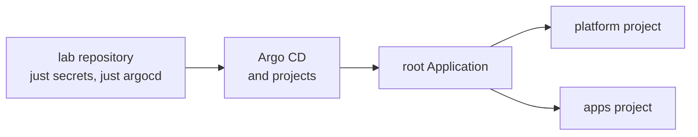

# k8s-flightsim-gitops

Desired state of the [k8s-flightsim](https://github.com/s3n-ops/k8s-flightsim)
lab cluster. Argo CD watches `main` and keeps the cluster in line with it.
Only declarative manifests live here.

## At a glance

- App of apps: one root Application, one Application per component.
- Least privilege: two Argo CD projects, the `default` project allows nothing.
- `main` changes only through squash-merged pull requests that pass schema
  validation ([policy](GITHUB_RELEASE_POLICY.md)).
- No secrets in git, not even encrypted ones.
- One Gateway API entry point, one certificate per hostname.
- Every version is pinned, in exactly one file.

## How it works

| Sync wave | Application | Project | Source |
|---|---|---|---|
| -10 | local-path-provisioner | platform | `platform/local-path-provisioner` |
| -8 | cert-manager | platform | Jetstack Helm chart |
| -7 | cert-manager-issuers | platform | `platform/cert-manager-issuers` |
| -6 | envoy-gateway | platform | Envoy Gateway Helm chart (OCI), with Gateway API CRDs |
| -5 | cloudnative-pg | platform | CloudNativePG Helm chart |
| -4 | gateway | platform | `platform/gateway` |
| 0 | miniflux | apps | `apps/miniflux`, PostgreSQL with 3 instances |

A wave starts only after the Applications of the previous wave are
healthy. Argo CD needs a health check for Applications for that, set in
`argocd-cm` by `bootstrap/argocd`.

## Projects

| Project | Destinations | Cluster-scoped kinds |
|---|---|---|
| platform | `argocd`, `local-path-storage`, `cnpg-system`, `cert-manager`, `envoy-gateway-system`, `gateway` | Namespace, CRDs, webhooks, ClusterRoles, StorageClass, ClusterIssuer, GatewayClass |
| apps | `miniflux` | Namespace |

`bootstrap/argocd/projects.yaml` is applied by `just argocd`, not by the
root Application, so a merge here cannot widen its own rights.

## Gateway and TLS

The Gateway `gateway/lab` listens on `10.17.3.100`; the lab DNS points
`*.k8s-flightsim.internal` there. Each hostname has its own HTTPS listener,
certificate and list of namespaces allowed to attach routes. cert-manager
issues the certificates from an intermediate CA; the root stays offline,
and both are name-constrained to `k8s-flightsim.internal`. Port 80 only
redirects.

## Secrets

| Secret | Namespace | Created by |
|---|---|---|
| `miniflux-admin` | miniflux | `just secrets` |
| `miniflux-db-app` | miniflux | CloudNativePG |
| `lab-intermediate-ca` | cert-manager | `just secrets` |

## Bootstrap

From the lab repository: `just secrets`, then `just argocd`.

## License

MIT, see [LICENSE](LICENSE).

## AI Disclosure

Development was assisted by AI tools (Claude).
